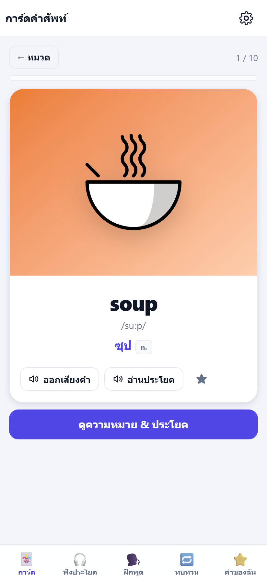
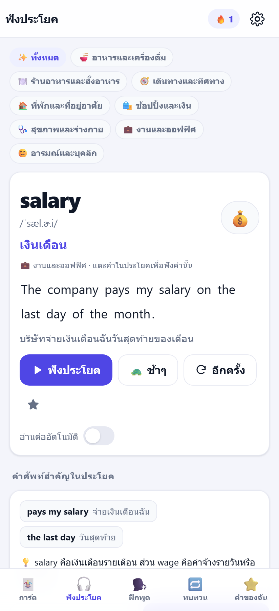

# PicEnglish — เว็บแอป/PWA เรียนคำศัพท์อังกฤษด้วยภาพ

แอปเรียนคำศัพท์ภาษาอังกฤษ **ด้วยภาพถ่ายจริง + เสียงอ่าน + ประโยคใช้งานจริง** สำหรับผู้ใหญ่ไทย
ทำงานในเบราว์เซอร์ล้วน ไม่มี backend ไม่มีค่าบริการ ไม่เก็บข้อมูลผู้ใช้ออกจากเครื่อง

> สร้างด้วย AI ทั้งหมด (DeepSeek Harness) — โค้ด vanilla JavaScript ไม่มีเฟรมเวิร์ก ไม่ต้องมีขั้นตอน build




---

## 1. มีอะไรในแอป

| ฟีเจอร์ | รายละเอียด |
|---|---|
| 🃏 **แฟลชการ์ดภาพ** | **ภาพกราฟฟิกน่ารัก (OpenMoji, ในเครื่อง 261 KB)** + คำ + IPA + ชนิดคำ + คำแปลไทย + ประโยคตัวอย่าง + คำอธิบายวิธีใช้ |
| 💬 **บทสนทนาจำลอง** | 8 สถานการณ์ชีวิตประจำวัน · แอปอ่านบทคู่สนทนา **คุณพูดบทของคุณ** แล้วให้คะแนน · **สลับบท**ได้ · พูดไม่ผ่านเข้าคิวทบทวนอัตโนมัติ |
| 🎧 **ฟังเสียงตัวเอง (A/B)** | บันทึกเสียงที่คุณพูด แล้วฟังสลับกับเสียงต้นแบบเพื่อเทียบจังหวะและเสียง (A/B) — เก็บในเครื่องเท่านั้น |
| 🔤 **สอนออกเสียงคำที่ยังไม่ชัด** | ระบบชี้คำที่ออกเสียงไม่ตรง · แตะคำเพื่อฟังช้าๆ + ดู IPA/คำแปล/ภาพ · มี **โหมดฝึกทีละคำ** จนครบแล้วกลับไปพูดทั้งประโยค |
| 🎯 **พูดจนกว่าจะผ่าน** | โหมดเข้ม (ค่าเริ่มต้น): ต้องพูดให้ถึงเกณฑ์ก่อนจึงไปประโยคถัดไป · ปรับเกณฑ์ได้ (60/70/85%) · ข้ามได้หลังลอง 3 ครั้ง |
| 🎧 **ฟังประโยค + ไฮไลท์คำ** | อ่านประโยคด้วยเสียงเบราว์เซอร์ แล้ว**ไฮไลท์คำที่กำลังอ่าน**แบบคาราโอเกะ (แตะคำใดก็ได้เพื่อฟังคำนั้น) |
| 🧠 **สรุปคำศัพท์สำคัญ** | ทุกประโยคมีวลีสำคัญ 2–4 รายการพร้อมคำแปล แตะเพื่อฟังเสียง |
| 🧩 **เกมจับคู่ภาพ-คำ** | 5 คู่ จับเวลา นับจำนวนครั้ง |
| ❓ **ควิซปรนัย** | 4 รูปแบบคำถามสลับกัน: ดูภาพเลือกคำ / ดูคำเลือกความหมาย / ดูความหมายเลือกคำ / เติมคำในประโยค |
| 🎤 **ฝึกออกเสียง** | พูดตามแล้วให้คะแนนทีละคำ (Web Speech Recognition) พร้อมระบายสีคำที่ออกเสียงถูก/ผิด |
| 🔁 **ทบทวน SRS (SM-2)** | คิวทบทวนอัตโนมัติแบบ Anki — คำที่จำได้จะถามห่างขึ้น คำที่ตอบผิดจะกลับมาเร็ว |
| ⭐ **คำของฉัน** | รายการโปรด / คำยาก / สถิติความแม่นยำรายคำ + สถิติรวมและสตรีคการเรียน |
| 🎨 **ภาพประกอบ 3 โหมด** | ภาพกราฟฟิกน่ารัก (แนะนำ, ออฟไลน์ 100%) · ภาพถ่ายจริง (Wikimedia) · อีโมจิ |
| 📴 **ออฟไลน์ (PWA)** | ติดตั้งลงมือถือได้ ตัวแอปและภาพที่โหลดแล้วใช้ได้โดยไม่ต้องต่อเน็ต |
| 🔒 **ส่วนตัว** | ความคืบหน้าอยู่ใน `localStorage` ของเครื่องเท่านั้น ไม่มีบัญชี ไม่มี analytics |

เนื้อหาเริ่มต้น: **96 คำ ใน 8 หมวด** (อาหาร · ร้านอาหาร · เดินทาง · ที่พัก · ช้อปปิ้งและเงิน · สุขภาพ · งานและออฟฟิศ · อารมณ์และบุคลิก)

---

## 2. เริ่มใช้ในเครื่อง (2 นาที)

แอปใช้ ES Modules + `fetch` จึง**ต้องเปิดผ่านเว็บเซิร์ฟเวอร์** (ดับเบิลคลิกไฟล์ `index.html` จะใช้ไม่ได้)

```bash
# วิธีที่ 1 — Python (มีอยู่แล้วบน macOS/Linux/Windows ส่วนใหญ่)
cd english-picture-app
python -m http.server 5173

# วิธีที่ 2 — Node
npx --yes serve . -l 5173
```

แล้วเปิด <http://localhost:5173>

> `localhost` นับเป็น secure context จึงใช้ไมโครโฟน (ฝึกออกเสียง) และ service worker ได้ตามปกติ

---

## 2.5. ย้ายโปรเจกต์ไปเครื่องอื่น (MacBook / Linux / Windows อีกเครื่อง)

โปรเจกต์นี้ **พกพาได้ทั้งหมด** — เป็นไฟล์ static + สคริปต์ Python ไม่มี dependency ที่ผูกกับระบบปฏิบัติการ
(ทดสอบแล้ว: ฟอนต์สร้างไอคอนและคำสั่ง `piper` มีตัวเลือกครบทุก OS)

### วิธีที่ 1 — คัดลอกโฟลเดอร์ (ง่ายสุด)
1. คัดลอก **โฟลเดอร์ `english-picture-app` ทั้งโฟลเดอร์** (ไม่ต้องคัดลอกอะไรนอกโฟลเดอร์นี้)
2. บนเครื่องใหม่ ตรวจความพร้อม:
   ```bash
   cd english-picture-app
   python3 scripts/check_env.py      # บอกว่ามีอะไรแล้ว/ขาดอะไร + คำสั่งเฉพาะเครื่องนั้น
   ```
3. ติดตั้งของที่ขาด (ปกติมีแค่ Chrome ถ้าจะรันเทสต์ และ Pillow/numpy ถ้าจะสร้างไอคอน)
4. รัน: `python3 -m http.server 5173` → เปิด <http://localhost:5173>

### วิธีที่ 2 — ผ่าน Git (แนะนำถ้าจะทำต่อหลายเครื่อง)
```bash
# บน Windows (ติดตั้ง git ก่อน: https://git-scm.com/download/win)
git init && git add . && git commit -m "PicEnglish: initial"
git branch -M main
git remote add origin https://github.com/<ผู้ใช้>/<repo>.git
git push -u origin main

# บน MacBook
git clone https://github.com/<ผู้ใช้>/<repo>.git
cd <repo> && python3 scripts/check_env.py
```

### สิ่งที่ต่างระหว่าง Windows → macOS

| เรื่อง | Windows | macOS |
|---|---|---|
| คำสั่ง Python | `python` | `python3` |
| Chrome สำหรับเทสต์ | `C:\Program Files\Google\Chrome\Application\chrome.exe` | `/Applications/Google Chrome.app/Contents/MacOS/Google Chrome` |
| ฟอนต์สร้างไอคอน | Segoe UI Bold | Arial Bold (สคริปต์รองรับแล้ว) |
| ffmpeg (แปลง MP3) | ไม่ต้องมี | ไม่ต้องมี (ใช้ `lameenc`) |

### สิ่งที่ไม่ต้องคัดลอก
- `node_modules/` (ไม่มีอยู่แล้ว) และไฟล์ temp ของระบบ
- `data/audio/` ถ้ายังไม่ได้สร้างเสียง — สร้างใหม่ได้ด้วย `scripts/generate_audio.py`
  (ถ้าสร้างไว้แล้วให้คัดลอกไปด้วย เพราะแอปจะใช้เสียงชุดนั้นทันที)

### เตรียม MacBook ให้พร้อม (ครั้งเดียว)
```bash
xcode-select --install                  # ให้มี git/make
brew install node python                # หรือใช้ตัวติดตั้งจากเว็บ
python3 -m pip install --user pillow numpy
python3 scripts/check_env.py            # ต้องขึ้น "ของจำเป็นครบ"
```

### ทำต่อด้วย AI (Codex / Cursor / Claude Code) บนเครื่องใหม่
มีไฟล์ **`AGENTS.md`** เขียนไว้ให้ AI อ่านแล้ว — กติกาที่ห้ามทำผิด, คำสั่งรัน/ทดสอบ, แผนที่โค้ด,
กฎการตรวจข้อมูล, สถานะงานที่เหลือ และ **บันทึกบั๊กที่เคยเจอ** (กันทำพลาดซ้ำ)
เพียงเปิดโฟลเดอร์นี้ในเครื่องมือ AI แล้วสั่งว่า "อ่าน AGENTS.md แล้วทำข้อ 1 ต่อ"

---

## 3. ขึ้นออนไลน์ (เลือกอันเดียว)

แอปเป็นไฟล์ static ทั้งหมด — อัปโหลดทั้งโฟลเดอร์ `english-picture-app` ได้เลย
**ไม่ต้องตั้งค่า build command และไม่ต้องตั้งค่า output directory** (หรือถ้าต้องใส่ ให้ใช้ `.`)

### Vercel (แนะนำ — เร็วและฟรี)
1. สมัคร <https://vercel.com> แล้วกด **Add New → Project**
2. เลือก **Deploy without Git** (หรือเชื่อม GitHub ก็ได้) แล้วลากโฟลเดอร์ `english-picture-app` ขึ้นไป
3. Framework Preset: **Other** → Deploy
4. ได้ URL เช่น `https://picenglish.vercel.app` (ต่อโดเมนตัวเองได้ที่ Settings → Domains)

### Netlify
1. ไปที่ <https://app.netlify.com/drop> แล้วลากโฟลเดอร์ทั้งโฟลเดอร์ไปวาง
2. เสร็จทันที ได้ URL `https://<ชื่อสุ่ม>.netlify.app` (เปลี่ยนชื่อ/โดเมนได้ใน Site settings)

### Cloudflare Pages
1. <https://dash.cloudflare.com> → **Workers & Pages → Create → Pages → Upload assets**
2. ลากโฟลเดอร์ขึ้นไป → Deploy

### GitHub Pages
```bash
cd english-picture-app
git init && git add . && git commit -m "PicEnglish"
git branch -M main
git remote add origin https://github.com/<ผู้ใช้>/<repo>.git
git push -u origin main
```
จากนั้นไปที่ repo → **Settings → Pages → Source: Deploy from a branch → main / (root)** → Save
แอปจะอยู่ที่ `https://<ผู้ใช้>.github.io/<repo>/` (ทุก path ในแอปเป็น relative จึงทำงานใต้ subpath ได้)

### หลัง deploy ควรทำ
- เปิด URL บนมือถือ → เมนูเบราว์เซอร์ → **เพิ่มไปยังหน้าจอหลัก** (จะได้ไอคอนและเปิดแบบเต็มจอ)
- เข้า **ตั้งค่า → ดาวน์โหลดภาพทั้งหมดไว้ใช้ออฟไลน์** (โหลดภาพ 96 คำไว้ในแคช ใช้ได้ตอนไม่มีเน็ต)
- **ต้องเป็น HTTPS** ไมโครโฟนและ service worker จึงจะทำงาน (ทุกเจ้าให้ HTTPS ฟรีอยู่แล้ว)

---

## 4. ต่อเป็น LINE MINI App (LIFF)

**สถานะ: โค้ดพร้อมใช้แล้ว** — เหลือเพียงใส่ LIFF ID (ไม่ต้องแก้โค้ด) และดูหน้าตาก่อนได้ที่
[`docs/liff-preview.html`](docs/liff-preview.html) หรือเปิด `index.html?preview=liff`

### สิ่งที่ใส่ไว้ให้แล้วในแอป
- `js/liff.js` — โหลด LIFF SDK เฉพาะเมื่อมีการตั้งค่า (ถ้าไม่ตั้งค่า แอปทำงานเป็นเว็บ/PWA ปกติ)
- **ปรับหน้าจออัตโนมัติ** — เผื่อระยะ safe area ด้านล่าง กันแถบแท็บชนปุ่มของ LINE
- **แสดงชื่อ/รูปผู้ใช้ LINE** บนแถบหัว (เข้าสู่ระบบอัตโนมัติ ไม่ต้องมีหน้าล็อกอิน)
- **ปุ่ม "💚 แชร์ให้เพื่อนใน LINE"** ในหน้าตั้งค่า (`liff.shareTargetPicker`) — ช่องทางเติบโตที่สำคัญมาก
- **โหมดพรีวิว** (`?preview=liff`) — จำลองสภาพแวดล้อม LINE เพื่อดูหน้าตา/ทดสอบได้โดยไม่ต้องสมัครอะไร

### ขั้นตอนเปิดใช้จริง (4 ขั้น)
1. **Deploy ให้ได้ URL แบบ `https://…`** (Vercel / Netlify / Cloudflare Pages — ฟรี ดูข้อ 3)
2. เข้า <https://developers.line.biz/console/> → สร้าง Provider → **Create a LIFF app**
   - **Endpoint URL**: URL ที่ deploy
   - **Size**: `Full`
   - **Scopes**: `profile`, `openid`
3. คัดลอก **LIFF ID** (รูปแบบ `1234567890-AbCdEfGh`) ไปวางใน `index.html`:
   ```html
   <meta name="liff-id" content="1234567890-AbCdEfGh" />
   ```
   *(หรือทดลองชั่วคราวด้วย `?liffId=1234567890-AbCdEfGh` โดยไม่ต้องแก้ไฟล์)*
4. เปิด LIFF URL บนมือถือในแอป LINE → ใช้งานได้ทันที

### ข้อควรระวังเมื่ออยู่ใน LINE
- **เสียงอ่าน (TTS)** ทำงานได้ แต่บน iOS จะเริ่มเล่นได้หลังผู้ใช้แตะหน้าจอก่อนเท่านั้น (ข้อจำกัดของ WebKit)
- **ไมโครโฟน**: LINE in-app browser ของ iOS อาจขอสิทธิ์ไม่ผ่าน — แนะนำให้เปิดผ่าน Safari/Chrome ถ้าจะใช้โหมดฝึกออกเสียง
- ถ้าจะผูกคะแนนกับบัญชี LINE ต้องเพิ่ม backend เล็กๆ (Vercel Function) เพื่อยืนยัน ID token — **อย่าเชื่อ `liff.getProfile()` ฝั่ง client**
- ข้อมูลความคืบหน้ายังเก็บในเครื่องผู้ใช้ (localStorage) — ถ้าต้องการซิงก์ข้ามเครื่องต้องมี backend

---

## 5. โครงสร้างโปรเจกต์

```
english-picture-app/
├── index.html                 โครงหน้าเว็บ (topbar / view / tabbar)
├── manifest.webmanifest       ข้อมูล PWA (ชื่อ ไอคอน ธีม)
├── sw.js                      service worker: แคชตัวแอป + แคชภาพถ่าย
├── css/style.css              ธีมทั้งหมด (มีโหมดสว่าง/มืด, ปรับตามระบบ)
├── js/
│   ├── app.js                 router (hash), ธีม, ปุ่มตั้งค่า, ลงทะเบียน SW
│   ├── data.js                โหลด words/categories/dialogues + ตัวช่วยสุ่ม/ตัวลวง
│   ├── store.js               localStorage: SRS คำ+ประโยค, สถิติการพูด, คำโปรด, ตั้งค่า
│   ├── speech.js              TTS + ไฮไลท์คำ + Speech Recognition + เลือกเสียงผู้ชาย + ไฟล์เสียง
│   ├── recorder.js            บันทึกเสียงผู้ใช้ + เล่นย้อนหลัง + IndexedDB + โควตา/ลบอัตโนมัติ
│   ├── liff.js                เชื่อม LINE (LIFF): init, ชื่อผู้ใช้, ปุ่มแชร์, โหมดพรีวิว
│   ├── art.js                 ภาพกราฟฟิกน่ารัก (SVG ในเครื่อง) — โหลด manifest/ดึงภาพ/เครดิต
│   ├── images.js              ดึงภาพจาก Wikimedia Commons (หมวดหมู่ → ค้นข้อความ) + แคช
│   ├── ui.js                  ตัวช่วยสร้าง DOM, toast, bottom sheet, กล่องภาพ, แผงเลือกภาพ
│   ├── views.js               หน้าจอการ์ด/ฟัง/เกม/ทบทวน/คำของฉัน + หน้าตั้งค่า
│   └── views-speaking.js      โหมดฝึกพูด: ศูนย์รวม, บทสนทนาจำลอง, ทบทวนประโยค
├── data/
│   ├── art/                   ภาพกราฟฟิก SVG 96 ภาพ + manifest.json (261 KB ใช้ได้ออฟไลน์)
│   ├── words.json             ★ ข้อมูลคำศัพท์ที่แอปใช้จริง (สร้างจากสคริปต์)
│   ├── categories.json        ★ หมวดหมู่ที่แอปใช้จริง
│   ├── dialogues.json         ★ บทสนทนาที่แอปใช้จริง (สร้างจากสคริปต์)
│   ├── audio/                 ไฟล์เสียงที่สร้างไว้ล่วงหน้า + manifest.json (ถ้ามี)
│   └── raw/                   ต้นฉบับ: คำศัพท์แยกหมวด, dialogues/, image-hints.json
├── scripts/
│   ├── build_data.py          รวม raw/*.json → words.json + ตรวจสคีมา/ความสอดคล้อง
│   ├── build_dialogues.py     รวม raw/dialogues/*.json → dialogues.json + ตรวจกฎเนื้อหา
│   ├── make_voice_samples.py  สร้างเสียงตัวอย่างหลายเสียง + หน้ากดฟังเทียบ
│   ├── generate_audio.py      สร้างไฟล์เสียงทั้งชุด (Edge TTS หรือ Piper) + manifest
│   ├── make_icons.py          สร้างไอคอน PWA (PNG)
│   ├── build_art.py           ดาวน์โหลดภาพกราฟฟิกฟรี (OpenMoji/Twemoji) → data/art/
│   ├── check_imports.mjs      ตรวจว่า import ทุกตัวมีอยู่จริง (กันพิมพ์ผิด)
│   ├── e2e_test.mjs           ทดสอบจริงในเบราว์เซอร์ 99 ข้อ (คลิก/จำลองไมค์และเสียงพูด/ตรวจสถานะ)
│   ├── debug_speaking.mjs     เครื่องมือตรวจวงจรกดไมค์→พูด→ให้คะแนน (ใช้เมื่อมีปัญหา)
│   ├── screenshot.mjs         เก็บภาพหน้าจอทุกหน้าจอ
│   └── audit_images.mjs       ตรวจคุณภาพการจับคู่ภาพทั้ง 96 คำ
└── docs/
    ├── screenshots/           ภาพหน้าจอสำหรับเอกสาร
    ├── voice-samples/         เสียงตัวอย่างให้เลือก + index.html สำหรับกดฟังเทียบ
    ├── liff-preview.html     พรีวิวหน้าตาแอปเมื่ออยู่ใน LINE (ไม่ต้องสมัคร LINE Developers)
    ├── app-structure.md      โครงสร้างแอป/หมวดเนื้อหา/เส้นทางการเรียน (ฉบับปรับใหม่)
    ├── strategy-speaking.md   กลยุทธ์: ทำอย่างไรให้ผู้ใช้พูดได้จริง (พร้อมงานวิจัยอ้างอิง)
    └── spec-phase1-speaking.md สเปกเฟส 1 (โหมดฝึกพูด) ฉบับเต็ม
```

ไฟล์ที่แก้บ่อยคือ **`data/raw/*.json`** (เนื้อหา) และ **`css/style.css`** (หน้าตา)

---

## 6. เพิ่ม/แก้คำศัพท์

แก้ไฟล์ใน `data/raw/` (หนึ่งไฟล์ต่อหนึ่งหมวด ชื่อไฟล์ = รหัสหมวด) แล้วรวมใหม่:

```bash
python scripts/build_data.py
```

สคีมาของแต่ละคำ:

```json
{
  "id": "shopping-receipt",
  "word": "receipt",
  "pos": "n.",
  "ipa": "/rɪˈsiːt/",
  "thai": "ใบเสร็จ",
  "emoji": "🧾",
  "imageQuery": "shopping receipt paper",
  "example": "Could you give me a receipt for this purchase?",
  "exampleThai": "ขอใบเสร็จสำหรับการซื้อนี้ด้วยได้ไหม",
  "keyVocab": [
    { "en": "Could you", "thai": "คุณช่วย...ได้ไหม (สุภาพ)" },
    { "en": "purchase", "thai": "การซื้อ / สิ่งที่ซื้อ" }
  ],
  "tip": "receipt ออกเสียงว่า ri-SEET ตัว p ไม่ต้องออกเสียง"
}
```

สคริปต์จะตรวจให้อัตโนมัติ: คีย์ครบ, `id` ตรงรูปแบบและตรงหมวด, คำไม่ซ้ำกันข้ามหมวด,
`example` มีคำเป้าหมายอยู่จริง, และ **ทุก `keyVocab.en` ต้องเป็นข้อความที่ปรากฏจริงใน `example`**
(จุดนี้พลาดบ่อยและทำให้ไฮไลท์/คำแปลไม่ตรงกัน)

### เพิ่มหมวดใหม่
เพิ่มไฟล์ `data/raw/<รหัสหมวด>.json` แล้วเพิ่มรายการในตัวแปร `CATEGORIES` ใน
`scripts/build_data.py` (พร้อม `th`, `en`, `emoji`, `color`)

---

## 7. ระบบภาพทำงานอย่างไร (และข้อจำกัดที่ต้องรู้)

**ลำดับการหาภาพ**
1. **หมวดหมู่ Commons** จาก `commonsCategory` ของคำนั้น — ภาพตรงหัวข้อโดยโครงสร้าง (แม่นสุด)
2. **ค้นด้วยข้อความ** จาก `imageQuery` — ครอบคลุมกว้าง แต่ความแม่นยำต่ำกว่า
3. **ไม่พบภาพ → ใช้ภาพอีโมจิ** บนการ์ดไล่สี (ดูสวยและทำงานออฟไลน์ได้เสมอ)

**ระบบป้องกันอัตโนมัติ**
- ตัดภาพประเภทแผนที่/แผนภาพ/เอกสารสแกน/โลโก้/ปกหนังสือ ออก
- **ตัดภาพที่อาจไม่เหมาะสมกับทุกวัยออกเด็ดขาด** (ศัพท์ทางการแพทย์/บาดแผล/ภาพวาบหวิว) — ดู `UNSAFE_TITLE` ใน `js/images.js`
- คำที่ตั้ง `"photo": false` ใน `image-hints.json` จะใช้เฉพาะอีโมจิ (เหมาะกับคำนามธรรม/คำเกี่ยวกับอาการป่วย)
- ให้ความสำคัญกับภาพแนวนอน ไลเซนส์เปิด และภาพที่อยู่ในหมวด Featured/Quality

**ผลวัดจริงด้วย `node scripts/audit_images.mjs`** (96 คำ)

| ผล | จำนวน | ความหมาย |
|---|---|---|
| ภาพมาจากหมวดหมู่ที่ยืนยันแล้ว | **72 คำ** | ตรงหัวข้อโดยโครงสร้าง (ไม่ใช่การเดาจากคำค้น) |
| ใช้ภาพอีโมจิโดยตั้งใจ (`photo: false`) | **23 คำ** | คำนามธรรม/คำเกี่ยวกับอาการป่วย — ตั้งใจไม่ใช้ภาพถ่าย |
| ต้องตรวจด้วยตา | 1 คำ | `kind` (ภาพ "Helping the homeless" ซึ่งยังสื่อความหมายได้) |

หมวดหมู่ทั้ง 73 หมวดถูก **ตรวจสอบกับ Commons API จริง** ว่ามีอยู่และมีไฟล์ ≥ 5 ไฟล์ (`data/raw/image-hints.json`)

**ยังเหลืออะไรที่ต้องรู้**: แม้ภาพจะมาจากหมวดที่ถูกต้อง แต่ภาพ "อันดับหนึ่ง" ในหมวดอาจไม่ใช่มุมที่สื่อที่สุด
(เช่น หมวด Furniture มีภาพห้องจริงปนกับภาพอื่น) — นี่คือข้อจำกัดของคลังฟรีที่ไม่สามารถแก้ด้วยอัลกอริทึมได้หมด

**วิธีแก้ที่มีให้แล้ว**
- ปุ่ม **🖼 เปลี่ยนภาพ** บนการ์ด → เปิดแผงให้เลือกจากภาพที่เป็นไปได้ทั้งหมด แตะภาพที่ถูกใจแล้วระบบจำไว้ถาวร
- คำไหนหาภาพไม่ได้เลย → ใช้ **ตั้งค่า → ใช้ภาพถ่ายจริง: ปิด** เพื่อให้ใช้เฉพาะอีโมจิทั้งแอป (เร็วมากและออฟไลน์ 100%)

**ตรวจคุณภาพภาพทั้งชุด** (หลังแก้ `imageQuery`/`commonsCategory`)
```bash
python -m http.server 5173
chrome --headless --remote-debugging-port=9411 about:blank
node scripts/audit_images.mjs      # ได้ตารางบนจอ + docs/image-audit.json
```

**เชิงพาณิชย์/ลิขสิทธิ์**: ทุกภาพแสดง **ชื่อผู้ถ่าย + ไลเซนส์ + ลิงก์หน้าต้นทาง** ไว้ใต้ภาพอัตโนมัติ
ภาพ Commons ส่วนใหญ่เป็น CC BY / CC BY-SA / CC0 — ถ้าจะใช้เชิงพาณิชย์ต้องคงเครดิตไว้ (แอปทำให้แล้ว)
หรือเลือกเฉพาะคำที่ได้ภาพ CC0/Public Domain

---

## 8. เสียงอ่านและไมโครโฟน

แอปมี **2 ทางเลือกของเสียง** และเลือกใช้ให้เองตามที่มี

| ทาง | ข้อดี | ข้อเสีย |
|---|---|---|
| **เสียงของเบราว์เซอร์** (Web Speech API) — ค่าเริ่มต้น | ใช้ได้ทันที ฟรี ไม่ต้องโหลดอะไร | คุณภาพขึ้นกับเครื่องของผู้ใช้ (Windows/macOS/Android ได้เสียงคนละแบบ) |
| **ไฟล์เสียงที่สร้างไว้ล่วงหน้า** (แนะนำถ้าจะใช้จริงจัง) | เสียงผู้ชายคุณภาพสูง **เหมือนกันทุกเครื่อง** ฟังง่าย และออฟไลน์ได้ | ต้องสร้างไฟล์ก่อน deploy (ไม่กี่นาที) |

แอปตั้งค่าเริ่มต้นเป็น **เสียงผู้ชาย** เพราะฟังเข้าใจง่ายกว่าสำหรับผู้เรียนไทย
และเลือกเสียงผู้ชายอัตโนมัติจากชื่อเสียงในเครื่อง (Andrew / Brian / Guy / Christopher / Eric / Ryan / David …)
เปลี่ยนได้ที่ **ตั้งค่า → เสียงที่ต้องการ** (ผู้ชาย / ผู้หญิง / ดีที่สุดในเครื่อง) พร้อมปุ่มทดสอบเสียง

### ตัวเลือกเสียงฟรี (เรียงตามความเหมาะสมกับโปรเจกต์นี้)

| ตัวเลือก | ค่าใช้จ่าย | ใช้เชิงพาณิชย์ | ออฟไลน์ | คุณภาพ | หมายเหตุ |
|---|---|---|---|---|---|
| **Piper** (`en_US-ryan-high`, `en_US-joe-medium`, `en_GB-alan-medium`) | ฟรี | ✅ MIT | ✅ | ดี | เร็ว (~9 เท่าของ Kokoro บน CPU) ไฟล์เล็ก — **ปลอดภัยที่สุดถ้าจะขายจริง** |
| **Kokoro** (`am_michael`, `am_adam`, `bm_george`) | ฟรี | ✅ Apache-2.0 | ✅ | ดีมาก | ไฟล์โมเดลใหญ่กว่าและช้ากว่า Piper |
| **เสียงในเครื่องผู้ใช้** (Web Speech API) | ฟรี | ตามระบบปฏิบัติการ | ✅ | ปานกลาง–ดี | ขึ้นกับเครื่อง ไม่คงที่ |
| **Azure Speech** (`en-US-AndrewNeural`, `en-US-BrianNeural`) | ฟรี 500,000 ตัวอักษร/เดือน (ชั้น F0) | ✅ ตามเงื่อนไขบัญชี | ❌ (ต้องสร้างไฟล์ล่วงหน้า) | ดีมาก | **ตัวเลือกที่แนะนำถ้าอยากได้เสียงระดับพรีเมียมแบบถูกต้องตามเงื่อนไข** |
| **Edge TTS** (สคริปต์ `edge-tts`) | ฟรี ไม่ต้องมี key | ⚠️ ควรตรวจเงื่อนไขก่อน | ❌ | ดีมาก | เหมาะกับการทดลอง/ทำไฟล์ส่วนตัว |
| ElevenLabs / OpenAI TTS / PlayHT | มีค่าบริการ (มีโควตาฟรีจำกัด) | ✅ | ❌ | ดีมาก | เกินความจำเป็นสำหรับแอปนี้ |

### ขั้นตอนสร้างไฟล์เสียงทั้งชุด (คำ + ประโยค + บทสนทนา)

```bash
# 1) ติดตั้งเครื่องมือ (ครั้งเดียว)
pip install edge-tts             # หรือ  pip install piper-tts lameenc

# 2) ฟังเสียงตัวอย่างก่อนเลือก (สร้างหน้ารวมให้กดฟังเทียบ)
python scripts/make_voice_samples.py --edge --piper
#    → เปิด docs/voice-samples/index.html

# 3) สร้างไฟล์เสียงทั้งชุดด้วยเสียงที่เลือก
python scripts/generate_audio.py --engine edge  --voice en-US-AndrewNeural
python scripts/generate_audio.py --engine piper --voice en_US-ryan-high

# 4) ตรวจว่าได้ครบ
cat data/audio/manifest.json | head
```

สคริปต์จะเขียน `data/audio/manifest.json` และแอปจะเริ่มใช้ไฟล์เสียงเหล่านั้นทันที
(ถ้าไฟล์ใดหาย แอปจะถอยกลับไปใช้เสียงของเบราว์เซอร์ให้อัตโนมัติ ไม่มีทางพัง)

| ฟีเจอร์ | เทคโนโลยี | ข้อจำกัด |
|---|---|---|
| อ่านออกเสียง | Web Speech API (`speechSynthesis`) | ใช้เสียงของระบบปฏิบัติการ — คุณภาพต่างกันตามเครื่อง ผู้ใช้เลือกเสียงได้ในหน้าตั้งค่า |
| ไฮไลท์คำ | เหตุการณ์ `boundary` ของ utterance | ถ้าเบราว์เซอร์ไม่ส่งเหตุการณ์ (เช่น Safari บางเวอร์ชัน) แอปจะ**ประมาณเวลาต่อคำ**แล้วไฮไลท์ให้แทน |
| ฝึกออกเสียง | `SpeechRecognition` / `webkitSpeechRecognition` | ต้องใช้ **Chrome/Edge/Safari บน HTTPS** และต้องอนุญาตไมโครโฟน — Firefox ยังไม่รองรับ |

ผู้ใช้ที่ติดตั้งเสียงอังกฤษเพิ่มในระบบ (เช่นใน Windows: Settings → Time & language → Speech)
จะได้เสียงคุณภาพสูงขึ้น และเลือกได้ใน **ตั้งค่า → เสียงอ่านภาษาอังกฤษ**

---

## 8.5. โหมดฝึกพูดทำงานอย่างไร (สำคัญ)

**วงจรของแต่ละประโยค**

```
แอปอ่านบทคู่สนทนา → คุณกดไมค์พูด → บันทึกเสียง + ฟังเพื่อให้คะแนน (พร้อมกัน)
   → ได้คะแนน + คำที่ยังไม่ชัด  → [ฟังเสียงตัวเอง A/B] [ฝึกทีละคำ] [ฟังช้าๆ]
   → พูดซ้ำจนถึงเกณฑ์ → จึงไปประโยคถัดไป → ประโยคที่ยังไม่ผ่านเข้าคิวทบทวน
```

| กลไก | ค่าเริ่มต้น | ปรับได้ที่ |
|---|---|---|
| เกณฑ์ผ่าน | 70% | ตั้งค่า → เกณฑ์ผ่านการออกเสียง (60/70/85%) |
| ประตู "พูดจนกว่าจะผ่าน" | เปิด | ตั้งค่า → ต้องพูดให้ผ่านก่อนไปต่อ |
| บันทึกเสียงผู้ใช้ | เปิด | ตั้งค่า → บันทึกเสียงของฉัน |
| ข้ามได้เมื่อไร | หลังลอง 3 ครั้ง | — (กันผู้ใช้ติดกับจนท้อ) |

**ทำไมออกแบบแบบนี้**: งานวิจัยชี้ว่า AI/คู่สนทนาที่ไม่ตัดสินช่วยลดความกลัวพูดได้มาก
แต่งานวิจัยเดียวกันก็ชี้ว่าต้อง "ผลิตภาษา" ซ้ำ ๆ จึงจะพูดได้จริง
แอปจึงบังคับให้พูดซ้ำ**แต่ไม่มีคำว่าตก** และให้เครื่องมือช่วย (ฟังช้าๆ, แยกทีละคำ) แทนการกดดัน

**ข้อจำกัดที่ต้องรู้**: การให้คะแนนใช้ Speech Recognition ของเบราว์เซอร์ ซึ่งแม่นน้อยกับสำเนียงไทย
จึงตั้งเกณฑ์ไว้ต่ำ (70%) และมีปุ่ม "ลองอีกครั้ง" ให้กดได้เสมอถ้าแอปฟังผิด
ส่วน**การสอนออกเสียงใช้ IPA จากคลังคำศัพท์ 96 คำ** — คำที่อยู่นอกคลังจะฟังช้าๆ ได้แต่ไม่มีรูปคำอ่าน
## 9. ระบบทบทวน SRS (SM-2)

เหมือน Anki โดยย่อ — ใช้ 4 ระดับ

| ปุ่ม | ผลต่อรอบถัดไป |
|---|---|
| 😵 จำไม่ได้ | กลับมาถามในรอบนี้ และเริ่มนับใหม่ (~10 นาที) |
| ยาก | ห่างขึ้นเล็กน้อย |
| พอได้ | 1 วัน → 6 วัน → ตามด้วยตัวคูณ ease |
| ง่าย | ห่างขึ้นกว่าปกติ 30% |

ค่าที่คำนวณได้: `interval` (วัน), `ease` (ค่าความง่าย, ต่ำสุด 1.3), `reps`, `lapses`
โหมดทบทวนจะหยิบ **คำที่ครบกำหนด** + **คำใหม่ไม่เกินจำนวนที่ตั้งไว้ต่อวัน** มารวมกัน
ทุกเกมและทุกควิซจะป้อนผลเข้าระบบนี้ให้อัตโนมัติ

---

## 10. ทดสอบและบำรุงรักษา

> **ก่อน deploy ทุกครั้งที่แก้ไฟล์ในแอป**: เปิด `sw.js` แล้วเพิ่มเลข `VERSION` (เช่น `v1` → `v2`)
> เพื่อให้เครื่องที่เคยเปิดแอปอยู่แล้วได้รับไฟล์ชุดใหม่ (ไม่ค้างอยู่กับแคชเก่า)

```bash
# 1) ตรวจ import ทั้งโปรเจกต์ (จับ typo ก่อนรันจริง)
node scripts/check_imports.mjs

# 2) ตรวจไวยากรณ์ JS ทุกไฟล์
for f in js/*.js sw.js; do node --check "$f"; done

# 3) รวมและตรวจข้อมูลคำศัพท์
python scripts/build_data.py

# 4) ทดสอบการทำงานจริงในเบราว์เซอร์ (73 ข้อ)
python -m http.server 5173 &
chrome --headless --remote-debugging-port=9411 about:blank &
node scripts/e2e_test.mjs

# 5) เก็บภาพหน้าจอใหม่หลังแก้ CSS
node scripts/screenshot.mjs
```

`e2e_test.mjs` จะคลิกจริงในหน้าเว็บและตรวจ DOM/localStorage เช่น
การพลิกการ์ดต้องซ่อนด้านหน้าและแสดงด้านหลัง (ดักบั๊กการหมุน 3D ที่ทำให้ข้อความกลับด้าน),
ไอคอนต้องอยู่ในเนมสเปซ SVG จริง, แผงเลือกภาพต้องเปลี่ยนภาพบนการ์ดได้ ฯลฯ

---

## 11. ความเป็นส่วนตัว

- ไม่มีเซิร์ฟเวอร์ของตัวเอง ไม่มีบัญชีผู้ใช้ ไม่มี analytics ไม่มีโฆษณา
- ความคืบหน้า/คำโปรด/ประวัติทบทวนอยู่ใน `localStorage` ของเบราว์เซอร์เครื่องนั้น
- คำขอออกเน็ตมีเพียง: ดึงภาพจาก `commons.wikimedia.org` / `upload.wikimedia.org`
  (และ `static.line-scdn.net` ถ้าเพิ่ม LIFF)
- ส่งออก/นำเข้าข้อมูลได้จากหน้าตั้งค่า เพื่อย้ายเครื่องหรือสำรองข้อมูล

---

## 12. ไอเดียต่อยอด

- เพิ่มคำศัพท์เป็น 300–500 คำ (โครงสร้างรองรับอยู่แล้ว — เพิ่มไฟล์ใน `data/raw/`)
- เพิ่มโหมด "ประโยคของฉัน" ให้ผู้ใช้บันทึกประโยคที่เจอจริง
- เพิ่มเสียงเจ้าของภาษา (บันทึกไฟล์เสียงล่วงหน้า) แทน TTS ของระบบ
- เพิ่มระบบ sync ข้ามเครื่อง (ต้องมี backend) หรือใช้ LINE Login + Vercel KV
- เพิ่มรายงานสรุปสัปดาห์ (คำที่ลืมบ่อย, ความเร็วในการจำ)
- สร้างชุดคำเฉพาะทาง เช่น คำศัพท์โรงพยาบาล ร้านกาแฟ โลจิสติกส์

---

## 13. เครดิตและไลเซนส์ของภาพ

ภาพทั้งหมดดึงจาก **Wikimedia Commons** ตามไลเซนส์ของแต่ละภาพ (CC0 / CC BY / CC BY-SA / Public Domain)
แอปแสดง **ชื่อผู้ถ่าย + ชื่อไลเซนส์ + ลิงก์ไปยังหน้าต้นทาง** ไว้ใต้ภาพทุกภาพโดยอัตโนมัติ
และเครดิตเหล่านั้นจะแสดงในหน้าที่แสดงภาพด้วย (การ์ด, รายละเอียดคำ, แผงเลือกภาพ)

หากจะใช้งานเชิงพาณิชย์ โปรดตรวจไลเซนส์ของภาพที่คุณใช้จริงอีกครั้งที่หน้าต้นทางบน Commons
